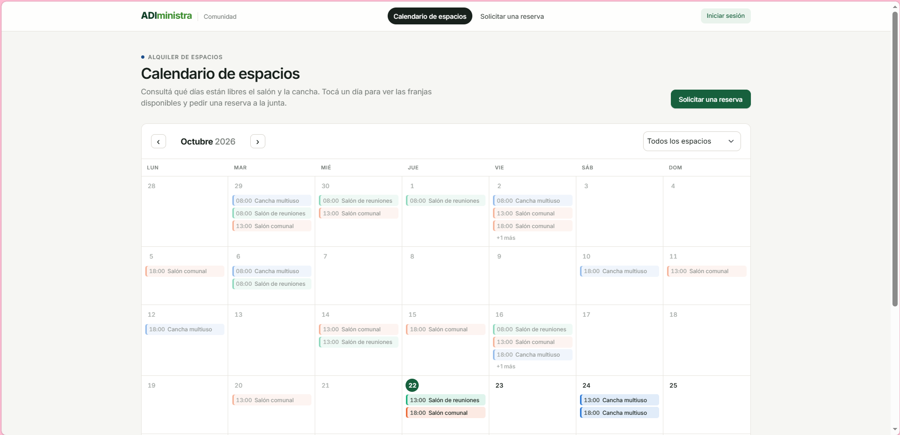
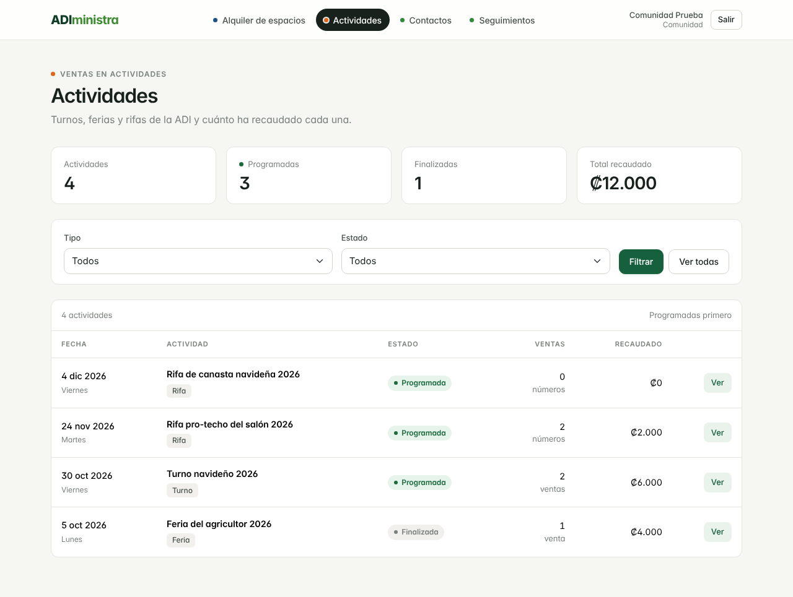
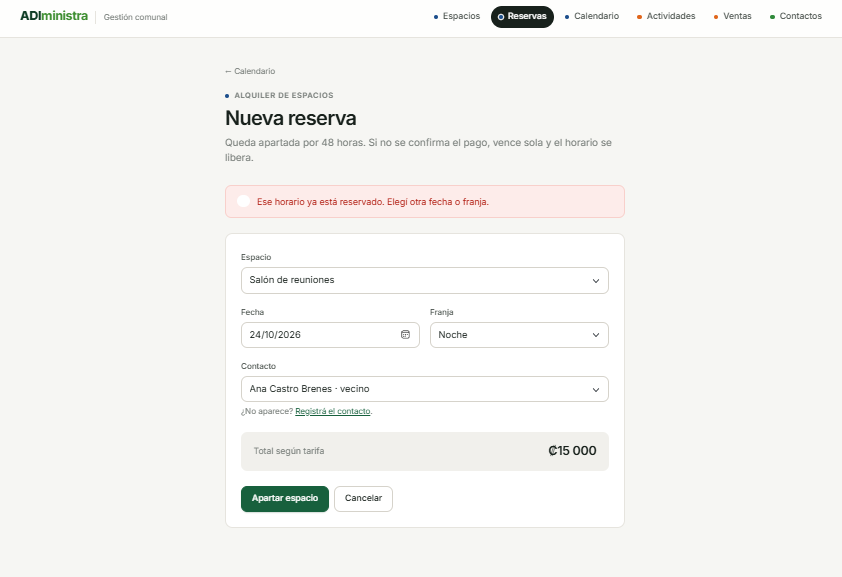
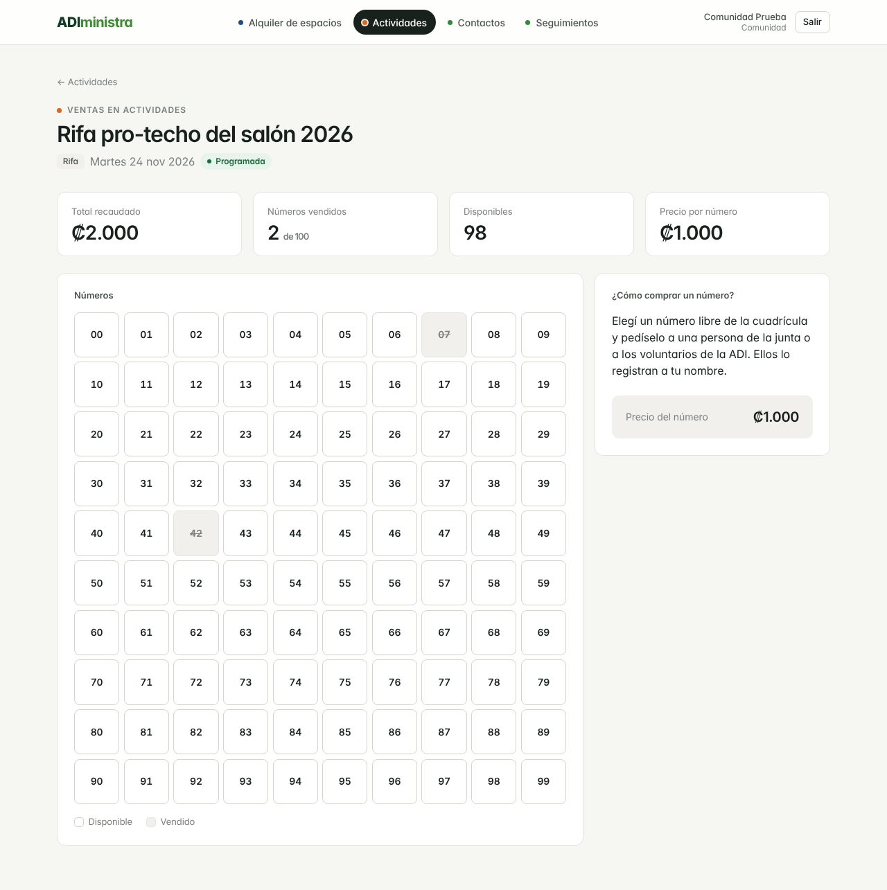
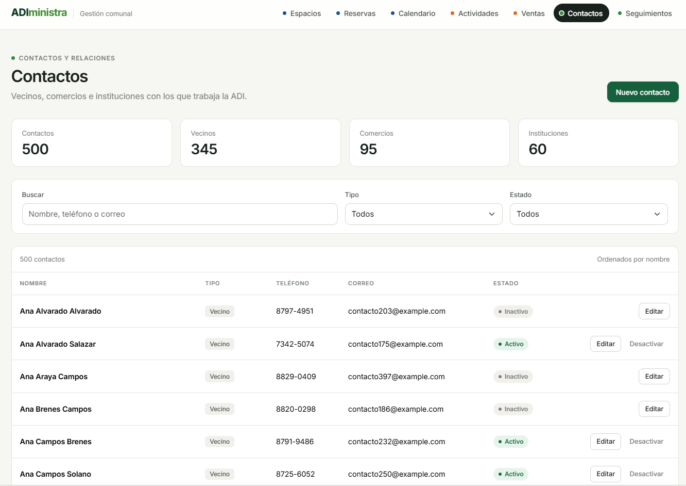
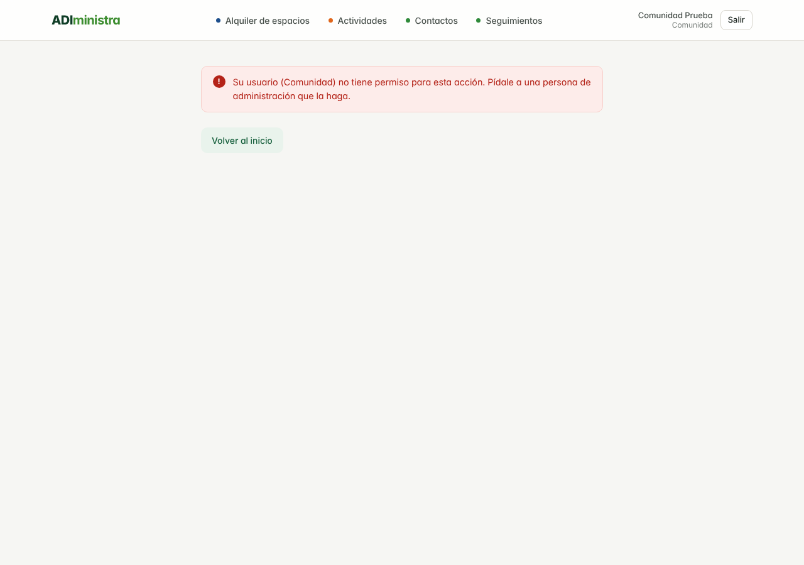

# ADIministra

**Sistema de gestión comunal para una Asociación de Desarrollo Integral (ADI).**

Proyecto Final · Tópicos Avanzados de Bases de Datos · Universidad Nacional · II-2026 · Grupo 4

> La ADI administra sus espacios, vende en sus actividades y cuida sus relaciones desde un solo sistema, sin dobles alquileres y sin perder ventas.

---

## 1. El problema

Una ADI se financia con tres fuentes: el alquiler del salón comunal y la cancha, las ventas en sus actividades (turnos, ferias y rifas) y el aporte de vecinos, comercios e instituciones. Hoy todo eso se lleva en cuadernos, mensajes de WhatsApp y hojas de Excel sueltas.

De ahí salen cuatro problemas que cuestan dinero y credibilidad:

| Problema | Qué provoca |
| --- | --- |
| **Dobles alquileres** | Dos personas reciben el salón o la cancha el mismo día a la misma hora. La ADI queda mal con una de las dos y a veces devuelve el dinero. |
| **Apartados que nunca se confirman** | Alguien aparta un horario, no paga y nadie lo libera. El espacio se queda bloqueado y se pierde el ingreso. |
| **Ventas que no cuadran** | Al cerrar una actividad nadie sabe cuánto se recaudó, y en las rifas se llega a vender dos veces el mismo número. |
| **Historial que se pierde** | Cuando cambia la junta directiva se va la memoria de quién alquiló, quién compró y quién patrocinó. Hay que volver a empezar las relaciones desde cero. |

**ADIministra** (de *ADI* + *administra*) resuelve los tres frentes en un solo sistema, y pone las reglas del negocio en la base de datos, no solo en el código.

## 2. Usuarios

| Usuario | Para qué usa el sistema |
| --- | --- |
| **Junta directiva de la ADI** | Ver el calendario de los espacios, confirmar pagos, revisar el total recaudado por actividad y consultar el historial de un contacto. |
| **Voluntarios de la ADI** | Registrar reservas, anotar ventas durante un turno o una feria y vender números de rifa. |
| **Comunidad (vecinos)** | Ver el calendario público de los espacios, pedir una reserva que la junta aprueba o rechaza, y consultar las actividades y los números de rifa libres. |

Cada persona entra con su cuenta y un rol: `admin` (junta y voluntarios) o `comunidad` (vecinos). El servidor revisa el rol en cada acción: una cuenta de comunidad no puede crear, editar ni borrar nada aunque escriba la dirección de la página. El vecino no reserva directo ni paga en línea: su solicitud la confirma la junta.

## 3. Alcance del MVP

### Qué entra

1. **Alquiler de espacios** — salón comunal y cancha, con tarifas por franja, calendario por espacio, apartados que vencen solos y cero dobles alquileres.
2. **Ventas en actividades** — turnos, ferias y rifas, con números de rifa sin repetir y el total recaudado por actividad.
   - Registro de actividades (turno, feria o rifa) con su fecha; al finalizarse dejan de aceptar ventas y su total queda cerrado.
   - Registro de ventas en turnos y ferias con varios productos por venta (cantidad y precio); el total lo calcula el sistema y el comprador es opcional.
   - Venta de los números 00 a 99 de cada rifa a un contacto, sobre una cuadrícula que muestra cuáles quedan libres.
   - Total recaudado, cantidad de ventas y productos más vendidos por actividad, calculados con aggregation pipeline.
3. **Contactos y relaciones** — registro de vecinos, comercios e instituciones, su historial (qué alquiló, qué compró, qué patrocinó) y recordatorios de seguimiento.

### Qué queda fuera

Son decisiones conscientes de alcance, no olvidos. Están en el roadmap:

- Dashboard de recaudación y uso de espacios.
- Ventas sin conexión (offline).
- Pagos en línea y notificaciones por WhatsApp.
- Soporte para varias ADI, gestión de afiliados y asambleas.
- Despliegue automático con GitHub Actions (CI/CD).

### Qué se va a demostrar

Estas cuatro pruebas son la demo en vivo del proyecto:

- Dos reservas simultáneas del mismo espacio, fecha y franja: **solo una pasa**.
- Un apartado sin confirmar **vence solo** y libera el horario.
- Un número de rifa **no se puede vender dos veces**.
- Las consultas **mejoran con índices**, medido sobre 100 000 ventas sintéticas.

## 4. Arquitectura y motor de datos

**Perfil A · un solo motor: MongoDB Atlas** (clúster M0, AWS Oregon). La exigencia del perfil no está en la cantidad de motores sino en la profundidad con que se usa el único que hay.

Cada regla del negocio la garantiza la base de datos:

| Regla del negocio | Cómo la resuelve MongoDB |
| --- | --- |
| Cero dobles alquileres | Índice único compuesto `{espacio_id, fecha, franja}` en `reservas`. El segundo intento falla en la base, no en el código. |
| Apartados que vencen solos | Índice TTL sobre el campo `vence`. Al confirmar el pago se hace `$unset` de `vence` y la reserva queda permanente. |
| Números de rifa sin repetir | Índice único `{rifa_id, numero}` en `rifas`. |
| Total recaudado por actividad | Aggregation pipeline sobre `ventas`. |
| Historial del contacto | `$lookup` desde `contactos` hacia `reservas` y `ventas`. |
| Datos válidos | JSON Schema en todas las colecciones. |

### Colecciones

| Colección | Contenido | Función clave |
| --- | --- | --- |
| `espacios` | Salón comunal, cancha y sus tarifas | JSON Schema |
| `reservas` | Apartados y alquileres confirmados | Índice único + índice TTL |
| `actividades` | Turnos, ferias y rifas | JSON Schema |
| `ventas` | Ventas registradas por actividad | Índices compuestos + aggregation |
| `rifas` | Números vendidos por rifa | Índice único |
| `contactos` | Vecinos, comercios e instituciones | JSON Schema |
| `seguimientos` | Recordatorios y notas de relación | `$lookup` para el historial |

### Diagramas

- Arquitectura v1: [`docs/arquitectura/arquitectura-v1.png`](docs/arquitectura/arquitectura-v1.png)
- Modelo de datos v1: [`docs/arquitectura/modelo-datos-v1.png`](docs/arquitectura/modelo-datos-v1.png)

### Evidencias del Perfil A

- **Volumen significativo:** ≥ 100 000 ventas sintéticas, con mediciones.
- **Funciones avanzadas:** aggregation pipeline, `$lookup`, JSON Schema, índices compuestos, únicos y TTL.
- **Comparación experimental:** consultas con y sin índice (`explain()`) y modelo embebido vs. referencias.

## 5. Tecnologías

| Uso | Herramienta |
| --- | --- |
| Base de datos | MongoDB Atlas (clúster M0 gratuito, AWS Oregon), base `adi` |
| Lenguaje | PHP 8.3 + extensión `mongodb` 2.4 + librería `mongodb/mongodb` 2.x (Composer) |
| Interfaz | HTML + Bootstrap 5 |
| Datos de prueba | `fakerphp/faker` — datos sintéticos, sin datos personales reales |
| Administración | MongoDB Compass y `mongosh` |
| Servidor | Virtualmin del curso: `grupo4.crnube.net/clientes2/proyecto` |
| Repositorio | GitHub (Issues, Projects, pull requests, tags y Releases) |

## 6. Instalación

> Aquí va el resumen. La guía completa paso a paso (requisitos, XAMPP, Atlas, scripts y solución de problemas) está en [`docs/instalacion.md`](docs/instalacion.md) y se valida en el Seguimiento 4 con una instalación desde cero.

**Requisitos:** PHP ≥ 8.1 con la extensión `mongodb` 2.x, Composer, Git y un clúster de MongoDB Atlas.

```bash
git clone https://github.com/JeanCarloB/proyecto_adi.git
cd proyecto_adi
composer install --no-dev
cp .env.example .env
# editar .env con la URI real del clúster
```

Variables de entorno (`.env.example`):

| Variable | Descripción |
| --- | --- |
| `MONGODB_URI` | Cadena de conexión del clúster de Atlas. **Nunca se sube al repositorio.** |
| `MONGODB_DB` | Nombre de la base de datos (`adi`). |
| `ALTCHA_HMAC_KEY` | Clave secreta del captcha del login y de las solicitudes (texto aleatorio de 32 caracteres o más). **Nunca se sube al repositorio.** |

Verificación: abrir `diagnostico.php` en el navegador con sesión de admin. Las seis comprobaciones (PHP, extensión, Composer, `.env`, conexión y escritura) deben salir en OK. Sin sesión se ven las cinco primeras; la escritura y los detalles de la base solo los ve administración.

**Cuentas de prueba:** `php scripts/crear_usuarios_prueba.php` crea `admin@example.com` y `comunidad@example.com` para probar el login y los permisos.

**Seguridad:** el clúster de Atlas solo acepta la IP del servidor (nunca `0.0.0.0/0`), un `.htaccess` bloquea el acceso web a `.env`, `vendor/`, `scripts/`, `docs/` y `.git/`, y en el repositorio solo vive `.env.example`. Las contraseñas se guardan con `password_hash`, los permisos por rol se validan en el servidor y los formularios de administración llevan token CSRF (ver [`docs/decisiones.md`](docs/decisiones.md#inicio-de-sesión-y-permisos-issues-96-97-y-98)).

## 7. Estructura del repositorio

```
.
├── src/                    Código de la aplicación
├── docs/
│   ├── arquitectura/       Diagramas de arquitectura y modelo de datos
│   ├── capturas/           Capturas de pantalla de cada seguimiento
│   ├── seguimientos/       Bitácoras S1.md a S4.md
│   ├── decisiones.md       Decisiones técnicas generales y de cada módulo
│   ├── instalacion.md      Instalación desde cero
│   ├── mediciones.md       Mediciones con y sin índice (explain)
│   ├── pruebas.md          Pruebas documentadas
│   └── ventas.md           Guía del módulo de ventas y guion de su demo
├── data/                   Datos de prueba
├── scripts/                Carga de datos sintéticos y mediciones
├── CHANGELOG.md            Cambios por versión
├── .env.example            Variables de entorno (sin credenciales)
├── .htaccess               Bloqueo web de archivos sensibles
├── composer.json           Dependencias PHP
├── diagnostico.php         Verificación de entorno y conexión
├── index.php               Portada con acceso a los módulos
├── login.php               Inicio de sesión con captcha
└── logout.php              Cierre de sesión
```

## 8. Flujo de trabajo

Todo cambio entra a `main` por pull request. La aplicación solo corre en el servidor; en las computadoras de los integrantes se edita el código y se hace push.

```bash
git checkout main
git pull origin main
git checkout -b feature/<tarea>
# ... programar ...
git add .
git commit -m "<descripción>"
git push origin feature/<tarea>
```

Después: pull request hacia `main`, revisión de otro integrante y merge. Quien hace el merge actualiza el servidor con `git pull --ff-only origin main`.

**Reglas:** nunca se editan archivos directamente en el servidor, el `.env` del servidor no se toca con `git pull`, y las URIs personales de Atlas no se comparten en Issues ni en el repositorio.

### Despliegue en el servidor

El servidor Virtualmin (`grupo4.crnube.net/clientes2/proyecto`) tiene un clon del repositorio que **solo puede leer**: se conecta a GitHub con una *deploy key* de solo lectura, así que desde el servidor nunca se hace push.

**Configuración inicial (una sola vez):**

1. En el servidor, generar la llave: `ssh-keygen -t ed25519 -C "servidor-adi" -f ~/.ssh/adi_deploy`.
2. En GitHub → *Settings → Deploy keys → Add deploy key*, pegar `~/.ssh/adi_deploy.pub` **sin** marcar *Allow write access*.
3. En `~/.ssh/config` del servidor:
   ```
   Host github-adi
     HostName github.com
     User git
     IdentityFile ~/.ssh/adi_deploy
   ```
4. Clonar en la carpeta pública del proyecto: `git clone git@github-adi:JeanCarloB/proyecto_adi.git proyecto`.
5. Crear el `.env` del servidor a partir de `.env.example`, con el usuario de Atlas de la aplicación. Este archivo no está en el repositorio y `git pull` no lo toca.
6. `composer install --no-dev`.
7. En Atlas, *Network Access* solo con la IP del servidor.
8. El `.htaccess` del repositorio bloquea `.env`, `vendor/`, `scripts/`, `docs/` y `.git/`. Comprobar que `https://grupo4.crnube.net/clientes2/proyecto/.env` devuelve 403 o 404.

**Después de cada merge a `main`** (lo hace quien fusionó el PR):

```bash
cd ~/public_html/clientes2/proyecto     # carpeta del clon en el servidor
git pull --ff-only origin main
composer install --no-dev               # solo si cambió composer.lock
```

Luego abrir `diagnostico.php` y confirmar que las 6 verificaciones siguen en OK. Si `git pull --ff-only` falla, es porque alguien editó archivos en el servidor: revisar con `git status` y descartar esos cambios, nunca hacer commit desde el servidor.

## 9. Equipo

| Integrante | Módulo | Responsabilidad |
| --- | --- | --- |
| Hazel Molina | Alquiler de espacios | Colecciones `espacios` y `reservas`, índice único anti-doble alquiler, índice TTL de apartados, CRUD y calendario |
| Kendall | Ventas en actividades | Colecciones `actividades`, `ventas` y `rifas`, venta de rifas con índice único, aggregation del total por actividad |
| María | Contactos y relaciones | Colecciones `contactos` y `seguimientos`, historial con `$lookup`, recordatorios, comparación embebido vs. referencias |
| Jean Carlo Bermúdez | Infraestructura, integración y seguridad | Repositorio, clúster Atlas, servidor, generador de 100 000 ventas sintéticas, mediciones con `explain()`, pruebas, login con roles y permisos |

## 10. Estado del proyecto

| Seguimiento | Semana | Entregable | Estado |
| --- | --- | --- | --- |
| S1 | 13 | Problema, arquitectura y repositorio · `v0.1.0` | Entregado · [bitácora](docs/seguimientos/S1.md) |
| S2 | 14 | Núcleo funcional · `v0.2.0` | Entregado · [bitácora](docs/seguimientos/S2.md) |
| S3 | 15 | Integración, pruebas y medición · `v0.3.0` | Entregado · [bitácora](docs/seguimientos/S3.md) |
| S4 | 16 | Release candidate · `v0.9.0` | En curso |

Los cambios por versión están en [`CHANGELOG.md`](CHANGELOG.md).

### Documentación

| Documento | Qué tiene |
| --- | --- |
| [`docs/instalacion.md`](docs/instalacion.md) | Instalación paso a paso y solución de problemas |
| [`docs/decisiones.md`](docs/decisiones.md) | Por qué el modelo, los índices y la seguridad quedaron así |
| [`docs/mediciones.md`](docs/mediciones.md) | Consultas con y sin índice: `explain()`, 3 corridas y mediana |
| [`docs/pruebas.md`](docs/pruebas.md) | Pruebas P1 a P9 con pasos, resultado esperado y obtenido |
| [`docs/ventas.md`](docs/ventas.md) | Guía del módulo de ventas y guion de su demo |
| [`docs/seguimientos/`](docs/seguimientos/) | Bitácoras S1 a S4 |

### Capturas

| Alquileres | Ventas |
| --- | --- |
|  |  |
| Calendario público: la comunidad ve qué horarios están ocupados, sin datos de las personas. | Actividades para la comunidad: totales y números libres, sin acciones ni compradores. |
|  |  |
| El índice único rechaza un segundo alquiler del mismo horario. | Rifa vista por la comunidad: los números vendidos salen tachados y no se pueden volver a vender. |

| Contactos | Seguridad |
| --- | --- |
|  |  |
| Contactos de la ADI con acceso a su historial. | Una cuenta de comunidad que intenta una acción de administración recibe 403. |

Más capturas en [`docs/capturas/`](docs/capturas/).

## 11. Roadmap

- **En 1 mes:** dashboard de recaudación y uso de espacios; exportación de reportes.
- **En 6 meses:** notificaciones por WhatsApp, pagos en línea y soporte para varias ADI.
- **Posible trabajo final de graduación:** gestión de afiliados, asambleas y votaciones.

## 12. Licencia

MIT. Ver [`LICENSE`](LICENSE).
