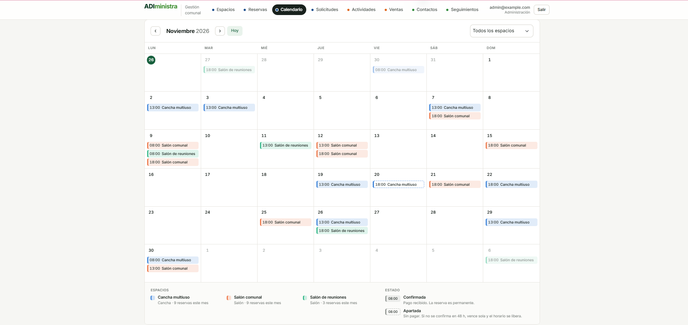
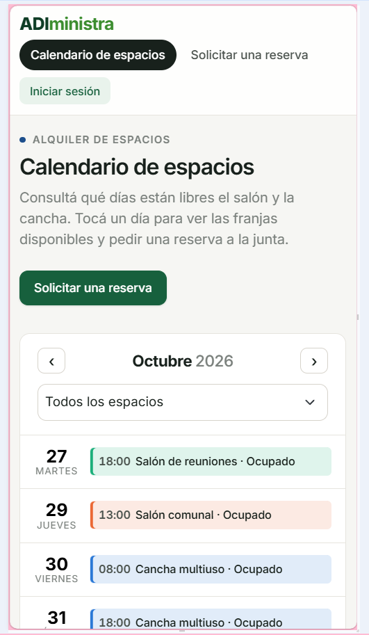
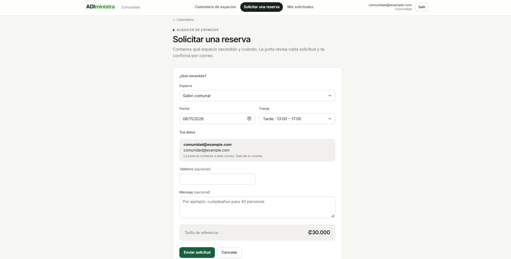
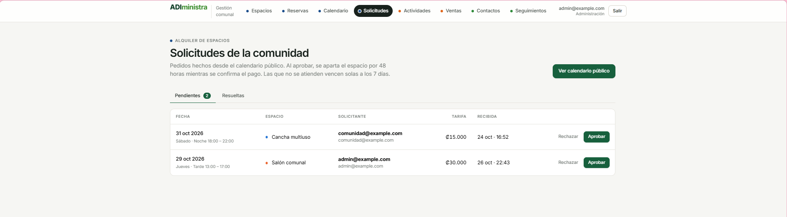
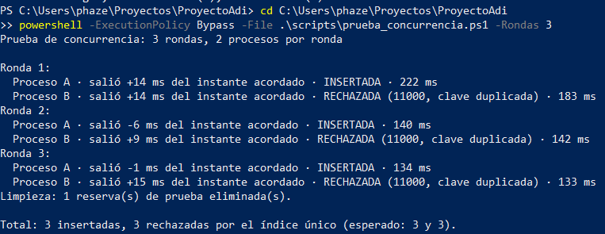
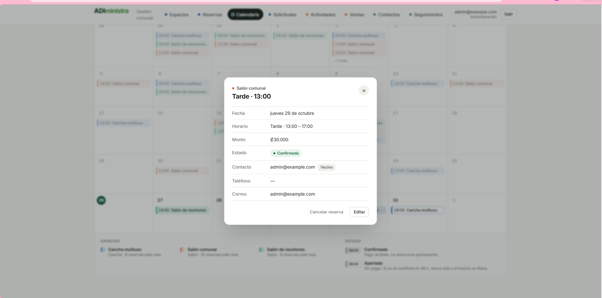
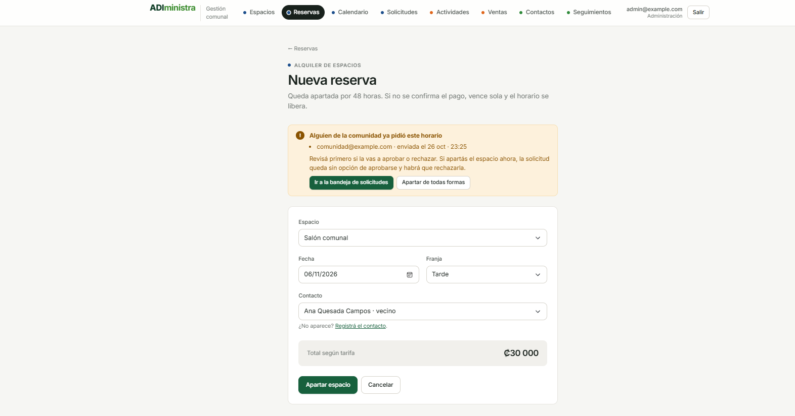

# Módulo de alquiler de espacios

Guía del módulo para la demo y la entrega final: qué hace, cómo se demuestra y qué se corrigió en cada seguimiento. Las decisiones de diseño están en [`decisiones.md`](decisiones.md#módulo-de-alquileres-issue-18), las pruebas en [`pruebas.md`](pruebas.md) (P4 a P6) y las mediciones en [`mediciones.md`](mediciones.md#módulo-de-alquileres-issue-17).

## Qué hace

| Pantalla | Administración | Comunidad |
| --- | --- | --- |
| **Espacios** (`src/espacios/`) | Crea, edita, activa y desactiva el salón y la cancha, con su tarifa por franja | No aparece |
| **Calendario de la junta** (`src/reservas/calendario.php`) | Mes completo con apartados y confirmadas, tarjeta de cada día y de cada reserva: confirmar pago, editar o cancelar | No aparece |
| **Reservas** (`src/reservas/`) | Listado con filtros y paginación; apartar un horario (vence a las 48 h si no se paga) | No aparece |
| **Solicitudes** (`src/reservas/solicitudes.php`) | Bandeja de pedidos de la comunidad: aprobar (aparta el espacio) o rechazar con motivo | No aparece |
| **Calendario público** (`src/publico/calendario.php`) | Mismo calendario que ve la comunidad | Ve qué horarios están ocupados, sin nombres ni montos. Se abre sin iniciar sesión |
| **Solicitar y Mis solicitudes** (`src/publico/`) | — | Con su cuenta, pide un espacio, día y franja; ve en qué quedó y puede retirarla mientras esté pendiente |



## Guion de la demo (3 a 4 minutos)

Preparación: índices con `scripts/crear_colecciones.js` y los usuarios de prueba de `scripts/crear_usuarios_prueba.php`. Conviene tener dos ventanas: una con la sesión de administración y otra, en modo incógnito, sin sesión (luego con la de comunidad), y una terminal en la carpeta del proyecto para la prueba de concurrencia.

1. **Calendario público, sin iniciar sesión.** Abrir el calendario de espacios en la ventana de incógnito y tocar un día: se ven las franjas libres con su tarifa.
   - **Qué decir:** la comunidad solo ve qué está ocupado, nunca quién alquiló. La consulta pide únicamente `{_id: 0, espacio_id, fecha, franja}`, los mismos campos del índice, así que es una consulta **cubierta**: MongoDB responde sin abrir ningún documento (0 documentos leídos en `explain()`).

   

2. **Pedir una reserva (comunidad).** Tocar *Solicitar* en una franja libre: pide iniciar sesión y vuelve al formulario con el día y la franja ya puestos. Enviar la solicitud.
   - **Qué decir:** los datos de contacto salen de la cuenta, no del formulario. La solicitud vence sola a los 7 días (índice TTL sobre `expira`), y un índice único parcial impide que la misma persona pida dos veces el mismo horario mientras espera.

   

3. **Aprobar la solicitud (administración).** En *Solicitudes*, tocar *Aprobar*.
   - **Qué decir:** aprobar escribe en tres colecciones (contacto, reserva y solicitud) dentro de una **transacción**. Si el horario se ocupó entre tanto, el índice único rechaza la reserva y se deshace todo: nunca queda una solicitud aprobada sin su reserva.

   

4. **Intentar apartar el mismo horario otra vez.** En *Nueva reserva*, elegir el mismo espacio, día y franja: aparece "Ese horario ya está reservado".
   - **Qué decir:** no es una revisión en PHP. El índice único `{espacio_id, fecha, franja}` rechaza el segundo insert con el error 11000.

   

5. **Dos reservas en el mismo instante.** En la terminal:

   ```powershell
   powershell -ExecutionPolicy Bypass -File .\scripts\prueba_concurrencia.ps1 -Rondas 3
   ```

   Tarda unos 20 segundos. En cada ronda un proceso queda *INSERTADA* y el otro *RECHAZADA (11000)*.
   - **Qué decir:** revisar primero y después insertar no alcanza, porque el otro puede colarse en medio. Solo la base puede garantizarlo. El ganador cambia de ronda a ronda: es una carrera real (prueba P4).

   

6. **Apartado que vence solo.** En el calendario de la junta, tocar la reserva aprobada: está *Apartada* y muestra cuándo vence. Tocar *Confirmar pago*: pasa a *Confirmada*.
   - **Qué decir:** el apartado lleva un campo `vence` con un índice TTL; si nadie paga en 48 horas, MongoDB lo borra y el horario se libera sin ninguna tarea programada. Confirmar el pago hace `$unset` de `vence`, y el TTL ya no lo toca. En la prueba P5, un apartado de 60 segundos desapareció 22 segundos después de vencer (el monitor TTL corre cada ~60 s).

   

7. **La junta no pisa una solicitud sin darse cuenta.** Con una solicitud pendiente, intentar apartar ese mismo horario desde *Nueva reserva*: la app avisa que alguien de la comunidad ya lo pidió y manda a la bandeja.

   

8. **Permisos en el servidor.** Con la sesión de comunidad, abrir `src/reservas/index.php`: termina en el calendario público. La regla está en el servidor, no en esconder el botón (prueba P6).

**Si el profesor pregunta:**

- *¿Por qué las tarifas van dentro del espacio y las reservas aparte?* Las tarifas son tres por espacio, cambian poco y siempre se leen con él. Las reservas crecen sin límite (cientos por año): embebidas harían crecer el documento del espacio para siempre.
- *¿Qué pasa si sube la tarifa?* El monto se copia a la reserva al crearla, así que las reservas viejas conservan el precio acordado.
- *¿Por qué `$in` sobre `espacio_id` en el calendario?* El índice empieza por `espacio_id`; filtrar solo por fecha haría un `COLLSCAN`. Con `$in` de los espacios activos, el `$lookup` del calendario de la junta lee 33 reservas en lugar de 389.
- *¿Cómo se evita reutilizar el captcha?* Cada reto resuelto se guarda en `captchas_usados` con el reto como `_id`; el segundo uso choca con el `_id` y se rechaza. Un TTL borra los retos vencidos.

**Si el profesor pide un cambio en vivo:**

- *Cambiar las 48 horas del apartado:* `HORAS_APARTADO` en `src/includes/alquileres.php` y en `scripts/crear_colecciones.js`.
- *Cambiar los días que vive una solicitud:* `DIAS_SOLICITUD` en los mismos dos archivos.
- *Cambiar el horario de una franja:* `HORARIOS_FRANJA` en `src/includes/alquileres.php`.
- *Ver el plan de una consulta:* `mongosh "<URI>" --file scripts/medir_alquileres.js`, o en Compass `db.reservas.find({espacio_id: ..., fecha: ..., franja: ...}).explain("executionStats")`.

## Correcciones del módulo

### Seguimiento 2

| Corrección | Por qué | PR |
| --- | --- | --- |
| CRUD de espacios y reservas, y diseño común de la aplicación | Núcleo del módulo; el diseño lo usan los tres módulos | #22 |
| Calendario mensual con tarjeta del día, confirmar, cancelar y editar | Consultar disponibilidad y confirmar el alquiler desde una sola pantalla | #23, #62 |

### Seguimiento 3

| Corrección | Por qué | PR |
| --- | --- | --- |
| Calendario público, solicitudes y captcha en el login | La comunidad no tenía cómo ver ni pedir un espacio | #73 |
| Pruebas P4 (concurrencia) y P5 (TTL) en Atlas | Demostrar que la base, no el código, impide el doble alquiler y libera los apartados | #74 |
| Decisiones técnicas del módulo | Sección del módulo en `docs/decisiones.md` | #75 |
| Mediciones con `explain()` | Script `medir_alquileres.js`, 3 corridas y mediana | #76 |
| Prueba P6 de acceso por rol | 11 de 11 casos con capturas | #77, #78 |
| Rechazo con motivo en un cuadro de diálogo | El `prompt()` del navegador no dejaba ver qué se rechazaba | #78 |
| Aviso al apartar un horario que la comunidad ya pidió | La junta podía ocupar el horario sin enterarse de la solicitud | #78 |

### Seguimiento 4

| Corrección | Por qué | PR |
| --- | --- | --- |
| Prueba de instalación desde cero y guía corregida | 8 problemas encontrados en `docs/instalacion.md` | #108 |
| Esta guía, el guion de la demo y las capturas finales | Material para la exposición | este PR |

### Pendientes conocidos

- **Editar una reserva no avisa de solicitudes pendientes.** El aviso existe al crear una reserva, pero si se edita una y se mueve a un horario que alguien de la comunidad pidió, no avisa. El índice único sigue impidiendo el doble alquiler; solo falta el aviso.
- **La comunidad no paga en línea.** Pide el espacio y la junta confirma el pago a mano. Pagos en línea está en el roadmap.
