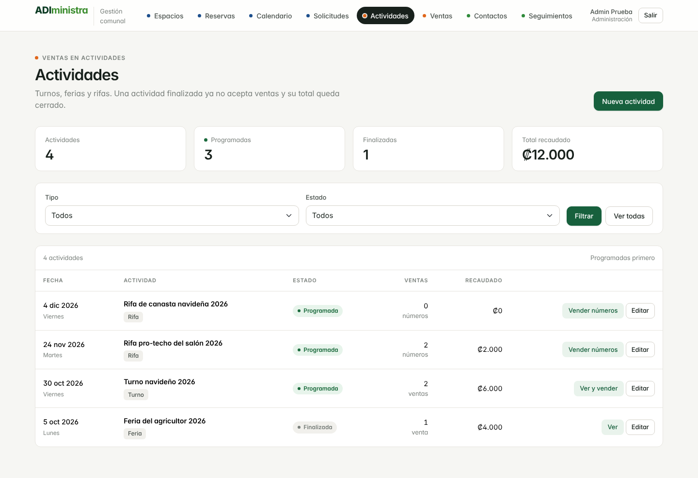
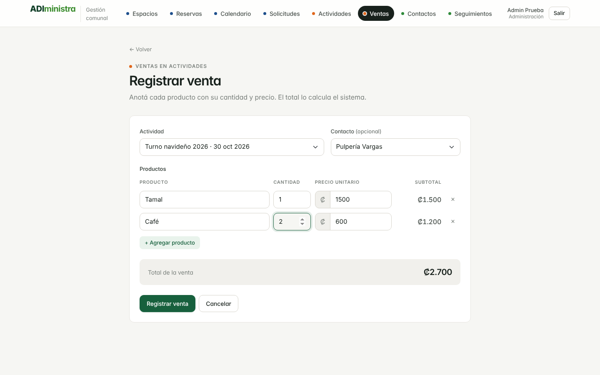
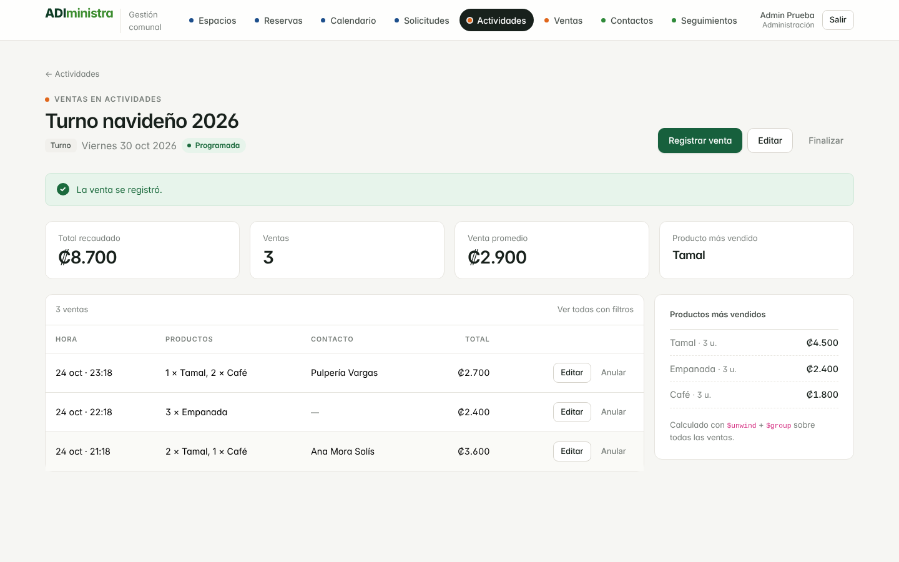
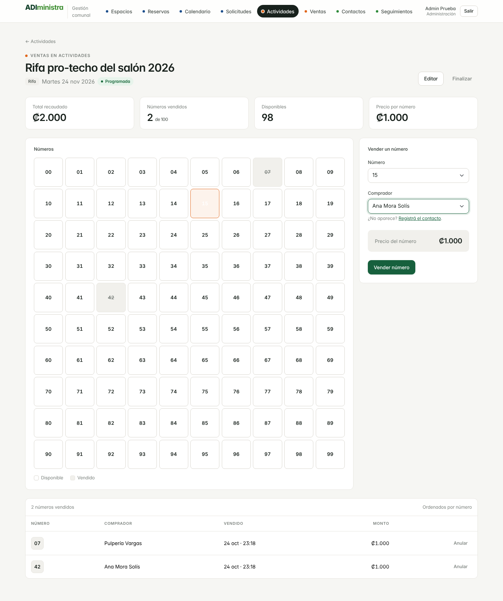
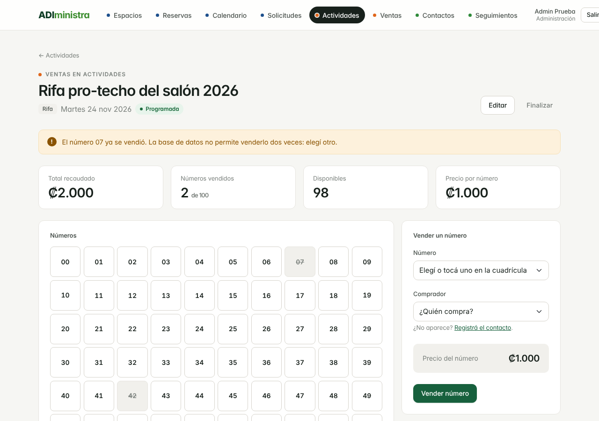
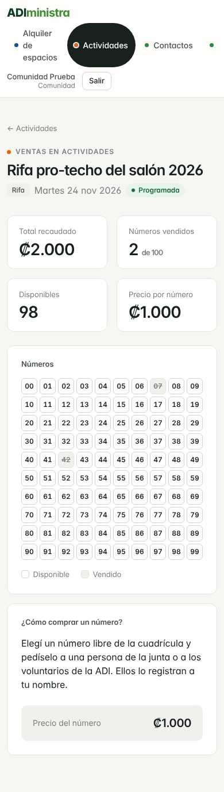

# Módulo de ventas en actividades

Guía del módulo para la demo y la entrega final: qué hace, cómo se demuestra y qué se corrigió en cada seguimiento. Las decisiones de diseño están en [`decisiones.md`](decisiones.md#módulo-de-ventas-en-actividades-issue-37), las pruebas en [`pruebas.md`](pruebas.md) (P7 a P9) y las mediciones en [`mediciones.md`](mediciones.md#módulo-de-ventas-issues-36-y-82).

## Qué hace

| Pantalla | Administración | Comunidad |
| --- | --- | --- |
| **Actividades** (`src/actividades/`) | Crea, edita, finaliza y reabre turnos, ferias y rifas | Ve las actividades con su estado y total recaudado |
| **Detalle de turno o feria** | Registra, edita y anula ventas; ve quién compró | Ve el total, la cantidad de ventas y los productos más vendidos; no el detalle de cada venta |
| **Detalle de rifa** | Vende y anula números en la cuadrícula 00–99 | Ve qué números quedan libres y el precio |
| **Ventas** (`src/ventas/`) | Listado de todas las ventas con filtros por actividad y fecha | No aparece |

## Guion de la demo (3 a 4 minutos)

Preparación: datos cargados con `scripts/cargar_datos.js`, índices con `scripts/crear_colecciones_ventas.js` y los usuarios de prueba de `scripts/crear_usuarios_prueba.php`. Conviene tener dos ventanas: una con la sesión de administración y otra, en modo incógnito, con la de comunidad.

1. **Registrar una venta (administración).** Entrar a Actividades, abrir un turno programado y tocar *Registrar venta*. Agregar dos productos (el precio se propone solo), elegir un contacto y guardar.
   - **Qué decir:** el total lo calcula el servidor, nunca el formulario. Los productos van embebidos en la venta.

   

2. **Ver el total recaudado.** En el detalle del turno, el total sube y aparecen los productos más vendidos.
   - **Qué decir:** el total no se guarda, se calcula con `$match` + `$group`, y los productos con `$unwind` + `$group`.

   

3. **Vender un número de rifa.** Abrir una rifa, tocar un número libre en la cuadrícula, elegir el comprador y vender.

   

4. **Intentar vender el mismo número otra vez.** Aparece "El número ya se vendió…".
   - **Qué decir:** no es una revisión en PHP. El índice único `{rifa_id, numero}` rechaza el segundo insert con el error 11000. Para mostrarlo con dos procesos a la vez está la prueba P7 (`scripts/prueba_rifa_concurrencia.ps1`).

   

5. **Finalizar la actividad.** Tocar *Finalizar* en el turno. Desaparecen *Registrar venta*, *Editar* y *Anular*, y el total queda cerrado.

6. **Vista de la comunidad.** En la otra ventana, abrir la misma rifa: se ven los números libres y el precio, pero no quién compró. Abrir el código HTML para mostrar que los nombres ni siquiera llegan.
   - **Qué decir:** para la comunidad, la consulta pide solo `{_id: 0, numero: 1}`, una consulta cubierta por el índice único que MongoDB responde sin abrir los documentos.

   

7. **Permisos en el servidor.** Con la sesión de comunidad, abrir `src/ventas/form.php`: responde 403. Esconder el botón no es la protección: la regla está en el servidor (prueba P9).

**Si el profesor pide un cambio en vivo:**
- *Cambiar el rango de números de la rifa:* `NUMEROS_RIFA` en `src/includes/ventas.php` y el `maximum` del esquema en `scripts/crear_colecciones_ventas.js`.
- *Agregar un producto sugerido:* `PRODUCTOS_SUGERIDOS` en `src/includes/ventas.php`.
- *Ver el plan de una consulta:* `db.ventas.find({actividad_id: ...}).explain("executionStats")` en Compass.

## Correcciones del módulo

### Seguimiento 3

| Corrección | Por qué | PR |
| --- | --- | --- |
| Control de acceso propio del módulo | La comunidad que abría Actividades terminaba en el calendario de alquileres, porque `ventas.php` heredaba el control de `alquileres.php` | #87 |
| Vistas de administración y comunidad | La comunidad veía los botones de acción y los nombres de quienes compraron cada número | #87 |
| Token CSRF en todas las acciones | Una página de otro sitio podía usar la sesión de alguien de la junta para vender o anular | #88 |
| Estado de actividad estricto | Un valor inventado en `estado` se guardaba como `programada` sin avisar | #88 |
| Listado de ventas con `$lookup` e índice `{fecha: -1}` | Hacía tres consultas y, sin filtro de actividad, leía y ordenaba las 100 000 ventas | #89 |
| Mediciones del módulo | Script `medir_ventas.js` con `explain()`, 3 corridas y mediana | #90 |
| Pruebas P7 a P9 | Rifa simultánea, datos inválidos, actividad finalizada y acceso por rol | #91 |
| Decisiones técnicas | Sección del módulo en `docs/decisiones.md` | #92 |

### Seguimiento 4

| Corrección | Por qué | PR |
| --- | --- | --- |
| `precio_numero` en las rifas de la carga de datos | Las rifas cargadas no se podían vender hasta editarlas una por una | #93 |
| Esta guía, el guion de la demo y las capturas finales | Material para la exposición | este PR |

### Pendientes conocidos

- **P7 y mediciones del módulo en Atlas.** Los scripts están listos (`prueba_rifa_concurrencia.ps1` y `medir_ventas.js`), pero hay que correrlos en Atlas y pegar los resultados (Issues #35, #36 y #85).
- **La comunidad no puede apartar un número desde el sistema.** Se lo pide a la junta, que lo registra. Hacerlo en línea necesitaría pagos o apartados con vencimiento, como las solicitudes de alquiler. Queda en el roadmap.
- **Barra de navegación de administración.** Con los 8 módulos, en pantallas de unos 1 280 px el botón *Salir* queda muy a la derecha. Es del diseño compartido (`layout.php`), así que se coordina con el resto del equipo.
